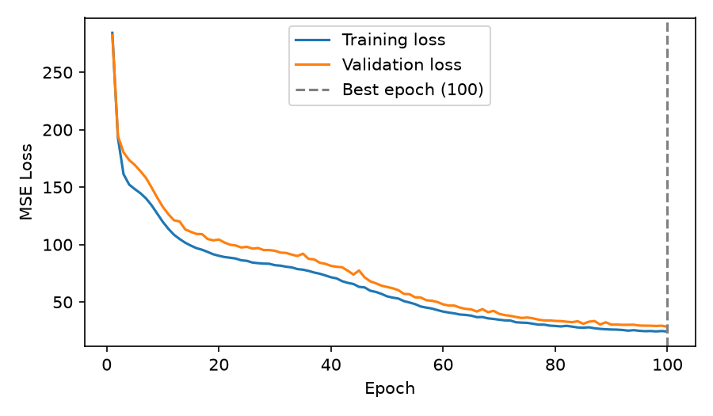
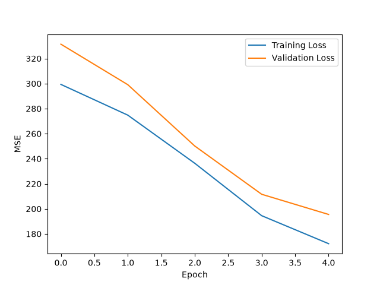

# Lakeshore Bike Demand – Lab 08

## Overview

This project uses neural networks built with PyTorch and Keras to predict how many bikes will be rented based on information such as the time of day, weather, and station type.

In Lab 07, I built a neural network using PyTorch and compared it with two simpler prediction methods.

For Lab 08, I recreated the same neural network using Keras. The goal was to see if both frameworks could make the same predictions and compare how well they performed during training.

## How to Run the Project

First, clone or download the GitHub repository and open the project folder in VS Code.

### Step 1: Create the Conda Environment

```bash
conda env create -f environment.yml
```

### Step 2: Activate the Environment

```bash
conda activate lab08-same-model-twice
```

### Step 3: Run the PyTorch Model

```bash
python train.py
```

This trains the PyTorch model and saves the results in the `reports` folder.

### Step 4: Run the Keras Model

```bash
python train_keras.py
```

This trains the Keras model and saves its learning curves and best model.

### Step 5: Compare Both Models

```bash
python compare.py
```

This runs both models using three different random seeds and saves the results in `reports/comparison.csv`.

### Step 6: Run the Tests

```bash
python -m pytest -v
```

This checks that the models and their main functions work correctly.

### Step 7: Check the Code

```bash
python -m ruff format --check .
python -m ruff check .
```

These commands check the formatting and look for code issues.

The provided `bikes_data.py` file was kept unchanged.

## Data and Split

The dataset contains 6,000 rows of bike rental data.

I divided the data into three groups:

| Data | Percentage | Rows |
|---|---:|---:|
| Training | 60% | 3,600 |
| Validation | 20% | 1,200 |
| Testing | 20% | 1,200 |

The training data teaches the model. The validation data helps check how well it is learning, and the test data is used to see how well it performs on data it has not trained on.

I used a random seed of 42 for the original run so the data would be split the same way each time.

I also made sure the data preparation steps were fitted using only the training data. This helps prevent the model from learning information from the validation or test data too early.

## Lab 07: PyTorch Model

For Lab 07, I created a neural network using PyTorch.

The model has two hidden layers with 16 neurons each. It uses ReLU activation functions and has one output that predicts the number of bike rentals.

For training, I used:

- **Loss function:** Mean Squared Error (MSE), which measures how far predictions are from the actual values.
- **Optimizer:** Adam, which helps the model adjust its weights while learning.
- **Batch size:** 64.
- **Epochs:** 100.
- **Random seed:** 42.

I shuffled the training data but not the validation or test data.

During training, I recorded the training loss, validation loss, and validation MAE.

I selected the best model based on the lowest validation loss.

### Lab 07 Results

I compared the neural network with two simpler methods:

- **Training mean:** Predicts the average number of rentals.
- **Linear regression:** Uses a linear relationship between the input information and bike rentals.

| Model | Validation MAE | Test MAE |
|---|---:|---:|
| Training Mean | 10.1539 | 9.6491 |
| Linear Regression | 9.3169 | 8.5729 |
| Neural Network | **3.6657** | **3.5093** |

MAE tells us how many bike rentals the predictions were off by on average. A lower number is better.

The neural network had the lowest error on both the validation and test data.

Its final test MSE was 27.2748.

This means the neural network was off by about 3.5 bike rentals on average when predicting the test data.

### Lab 07 Experiments

I tested three different learning rates to see how they affected the model.

| Experiment | Learning Rate | Best Epoch | Validation MAE |
|---|---:|---:|---:|
| Original | 0.001 | 100 | 6.6821 |
| Experiment 1 | 0.003 | 100 | 3.6657 |
| Experiment 2 | 0.0003 | 100 | 8.0796 |

Experiment 1 had the lowest validation error.

Increasing the learning rate to 0.003 helped the model learn faster, while the lower learning rate of 0.0003 gave the highest error after 100 epochs.

I chose Experiment 1 because it performed the best on the validation data.

### Lab 07 Learning Curves



The graph shows that the training and validation losses decreased over time, meaning the model was improving its predictions.

## Lab 08: Keras Model

For Lab 08, I built the same neural network using Keras.

I kept the model structure the same so I could compare it fairly with PyTorch.

Both models have:

- 8 input features.
- Two hidden layers with 16 neurons each.
- ReLU activation functions.
- One output neuron.
- 433 trainable parameters.

I also checked the parameter counts using hidden sizes of 8, 16, and 32. Both frameworks had matching counts.

### Copying the Weights

I copied the weights from the PyTorch model into the Keras model.

I then gave both models the same input data and compared their predictions before training.

The predictions matched within a tolerance of 1e-5.

This showed that both models could make the same predictions when they had the same weights.

### Training the Keras Model

I trained the Keras model using the same main settings as PyTorch:

- **Optimizer:** Adam.
- **Learning rate:** 0.001.
- **Loss function:** MSE.
- **Batch size:** 64.
- **Maximum epochs:** 100.

I also used early stopping to stop training if the validation loss stopped improving and saved the best model.

### Short Training Comparison

Before running the full comparison, I trained both models for 5 epochs using seed 42.

| Metric | PyTorch | Keras |
|---|---:|---:|
| Final Training Loss | 171.5349 | 172.1960 |
| Final Validation Loss | 194.4896 | 195.5255 |
| Best Epoch | 5 | 5 |

Both models improved during the short training run and had similar results.

PyTorch had a slightly lower validation loss in this test.

## PyTorch vs. Keras Results

I compared both models using random seeds 42, 43, and 44.

| Seed | Framework | Validation MAE | Test MAE |
|---|---|---:|---:|
| 42 | PyTorch | 6.6821 | 6.3971 |
| 42 | Keras | 6.2426 | 6.0630 |
| 43 | PyTorch | 6.4479 | 6.2413 |
| 43 | Keras | 5.6469 | 5.5718 |
| 44 | PyTorch | 5.9410 | 5.6197 |
| 44 | Keras | 5.8167 | 5.2953 |

Keras had a lower validation and test MAE for all three seeds.

PyTorch was faster to train in all three comparisons.

Both models reached their best validation results at epoch 100.

Even though I used the same model structure and training settings, the results were not exactly the same. This can happen because the frameworks handle parts of training differently.

The full results, including training times and best epochs, are saved in `reports/comparison.csv`.

For more details, see [COMPARISON.md](COMPARISON.md).

### Keras Learning Curves



The graph shows how the training and validation losses changed while the Keras model was learning.

Both losses decreased during training, showing that the model was improving.

## Testing

I kept the original Lab 07 tests and added new tests for Keras.

The Keras tests check:

- The model's output shape.
- The number of layers.
- The number of parameters.
- The activation functions.
- Whether copied PyTorch weights give matching predictions.
- Whether a saved Keras model gives the same predictions after loading.
- Whether the model can learn a small batch of data.
- Whether using the same random seed gives the same starting predictions.

All 10 Keras test cases passed.

## Limitations

The model was trained using the Lakeshore Bike Share dataset, so it may not predict bike rentals as accurately in other cities or bike-sharing systems.

It also cannot account for information that is not included in the dataset, such as special events, road closures, or unexpected changes in demand.

Although the neural networks performed well, their predictions are not always correct.

The comparison also only used three random seeds, so the results do not prove that one framework will always perform better than the other.

## Conclusion

In Lab 07, I found that the PyTorch neural network performed better than the two simpler prediction methods.

In Lab 08, I learned how to build the same neural network using Keras and compare the two frameworks.

Copying the weights showed that both models could make matching predictions before training.

After training, Keras had lower prediction errors in my three comparisons, while PyTorch trained faster.

Overall, both frameworks worked for this project, and the lab helped me understand how the same neural network can be built and trained using different tools.
